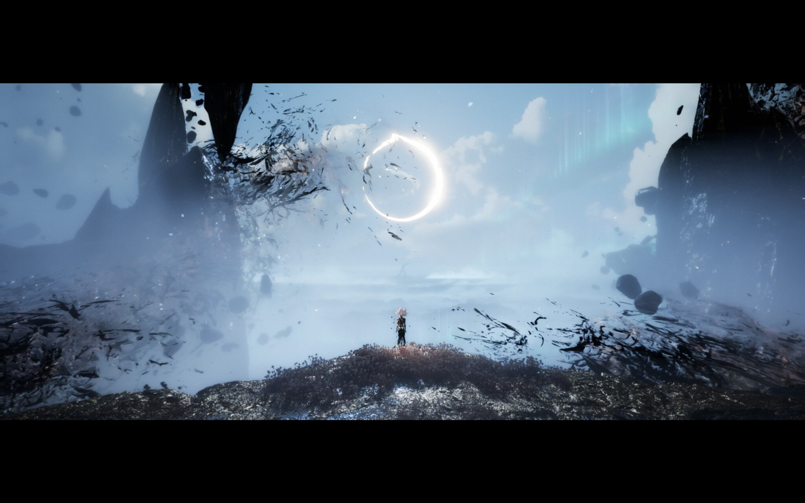
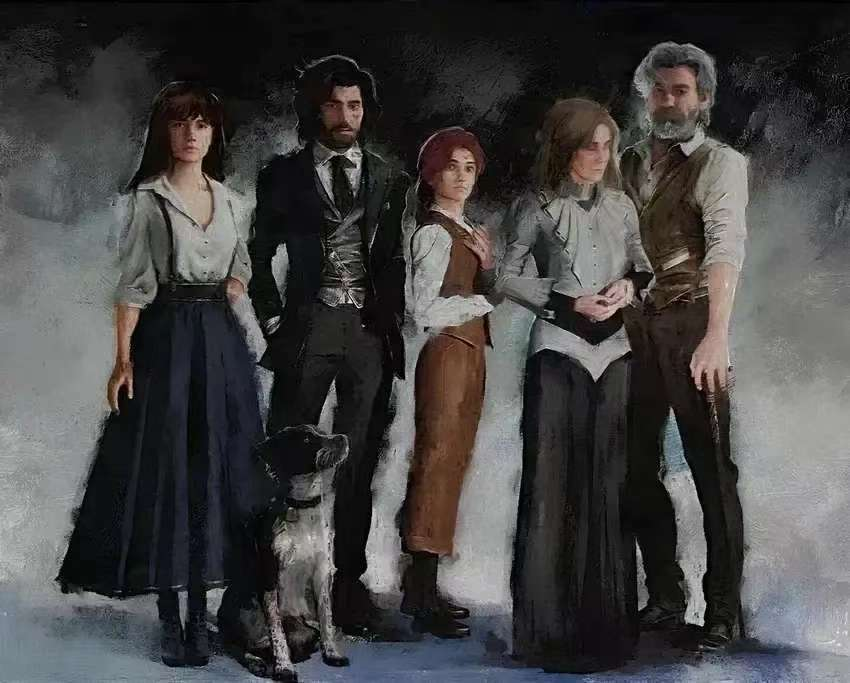

## 美好年代

故事要从19世纪末的法兰西说起。那是史称“美好年代”的岁月。巴黎灯火通明，沙龙里香槟与笑声一同升腾，莫奈把晨雾揉进画布，雷诺阿把阳光涂在舞会的裙摆上。整个世界仿佛都相信，明天只会比今天更好。

狄桑德一家就生活在这样的光里。母亲阿莉涅是画师协会的主席，笔下能让画中的世界活过来；父亲雷诺阿同样执笔，长女克莱雅天赋最高，长子维尔索偏爱音乐，幼女阿莉西亚偏爱文字。他们是那个时代最体面、也最令人羡慕的一家人。

然而光越亮，影子便越深。画师与文客之间的积怨早已暗流涌动，1905年12月的某一天，一场大火在狄桑德庄园燃起。那一天的日期是“12月33日”，历法上本不存在的一天。维尔索冲进火场救妹妹，没有再走出来。阿莉西亚活了下来，却失去了声音，半边脸被烧伤。日历从此再也翻不过去，一家人都停在了那个不存在的日子里。母亲找到了维尔索留在世上的唯一一幅画，那是他孩提时随手绘下的世界。她闭上眼睛，走了进去。

## 卢明城的最后一个黄昏

画里有一座城，叫卢明。城里的人早已习惯了一件事：每年，海的那一边，那座被称作纪石的巨碑上，会被写下一个数字。绘母把它画在石上，年龄等于或大于这个数字的人，便会在同一天化作花瓣，随风散尽。这被称为“抹煞”。数字一年比一年小，城里的人也一年比一年少。

序章里的那一天，抹煞日的清晨，人们没有哭，而是穿上最好的衣服，聚到街头，唱歌，跳舞，近乎庆祝般迎接这场屠杀。《Lumière》的旋律轻快得让人想笑，可仔细听，高昂的曲调底下藏着一丝不安，鼓点越敲越响。古斯塔夫陪着女友索菲站在人群里，她送给他的远征队队服还带着体温。数字落下，花瓣从人群中升起，红得像一场倒着下的雨。索菲在他怀里化作一缕花香，没有喊叫，也没有告别。

这一年，纪石上写下的数字是33。

## 踏上远征

卢明人没有就此认命。每年都有一支远征队出海，去寻找绘母，终结这场循环，而他们从来没有回来过。古斯塔夫是33号远征队的一名队员，同行的有一个把他当作兄长的少女玛埃尔，有性格冷静的吕涅，有温和而坚韧的熙艾尔。那些逝去的远征队前辈，他们都是在为后来者铺路。

船靠岸的那个夜晚，海滩上只剩下尸体与红色的花瓣。远征队被不知名的力量冲散，玛埃尔不见了。有人在暗处悄悄救下了她，也是这个人，在深夜替古斯塔夫取回了残破的机械臂。他叫维尔索，自称是0号远征队的幸存者，是一个永远不会衰老的人。

古斯塔夫找到了玛埃尔，也找到了前行的方向。海滩上的屠杀过后，他崩溃地喊出了那句脏话，什么使命，去他的使命。吕涅在一旁轻声说：“当有人倒下，不是如果。”他沉默了很久，终于重新站起来，继续往前走。此后的一路，他都在做同一件事：把自己所知道的一切，交到下一个人手里。他随身带着一本日记，把远征队的经验与心得一笔一笔记在上面，留给后来的人。蓄满电荷、挥出最强的一击时，他会喊：为了后来者。

这个人，仿佛一路都在为自己的离开做准备。

## 古斯塔夫之死

他们走到了石涛崖。

悬崖上风声很大，海浪拍在石壁上，碎成一片白。这一路最难缠的对手是经怪司灯，它提着那盏光芒冷冽的灯，在崖边的黑暗里等着他们。一场恶战之后，它终于倒下，几个人喘着气，有一瞬间连呼吸都是轻的。

人在最放松的时候，往往也最脆弱。雷诺阿就是在这一刻出现的。没有预兆，没有对话，甚至没有留给人一个转身的时间。一击，古斯塔夫便倒了下去。画面静得可怕。维尔索赶来救援，可惜晚了一步。

古斯塔夫躺在妹妹的怀里。玛埃尔低着头，手指攥着他的衣襟，说不出话来。他没有留下什么豪言壮语，也没有交代什么遗愿，在这样一个静谧得近乎温柔的瞬间，他的呼吸慢慢停了。玛埃尔最后做的一件事，是把他的机械手臂带走了。那是他的一部分，也是整支队伍从卢明出发时，最沉的一份托付。

## 废弃的古战场

维尔索就这样走进了队伍。他带着一身疲倦，站在废弃的古战场上，教玛埃尔新的剑招，帮忙安葬古斯塔夫，还把莫诺柯介绍给大家。他试着笑，试着融入，而玛埃尔把自己的臂章给了他，把古斯塔夫的那一枚留给了自己。

远征队一路走到废弃的古战场。画面里漫天红叶，空气里却满是铁锈的味道。这座战场见证过无数支远征队的败亡。维尔索走在他们的尸骨之间，沉默不语。他见过太多这样的结局，所有人都在为了一个看似正确的目标奔赴死亡，只有他知道，这趟路的终点并不是故事里说的那样。


## 宅邸

宅邸藏在画界的各个角落，几乎每一张小地图里都有一扇通往它的门。

玛埃尔夜里反复梦见同一个场景：白发的男人和蒙着面的女孩站在她面前，指责她，说一切都是她的错。她不明白。她只知道，那座宅邸令她感到一种说不清的熟悉，仿佛她曾经在这里长大。在宅邸门前，远征队第一次与雷诺阿正面对峙。他是远征队中的“艺策人”，是0号远征队的队长，也是维尔索曾经的同伴。他站在众人面前，神色沉重，像一个不得不动手的父亲。那一战打得并不轻松，而真正的重量，却在战后才压上来：这个想让所有人去死的男人，眼里没有恨。

## 纪石之下

穿过重重阻碍，远征队终于抵达了纪石。石的内部，是一间间按倒叙排列的记忆。最先看到的是烧毁的画作，火光仍在画布上舔舐；然后是阿莉涅教三个孩子绘画的午后；是她与丈夫之间愈发冷淡的沉默；是与女儿的争吵；是在琴边教维尔索弹琴的时光。再往深处，是与雷诺阿最美好的那段日子。

画中雷诺阿从那对相拥的身影下走了出来。这时，所有的碎片才拼在了一起。画里的世界，是母亲因为失去儿子而画下的；画里的人，是她按记忆描摹的家人，包括维尔索，包括丈夫，包括女儿；而每年的抹煞，是现实里的雷诺阿为了逼妻子出画，在这个世界里动的手。大崩析是他们夫妻在画里的一场大战，从那以后，世界只剩下被海洋隔开的一小块。画中永远复活的人是她，每年带来死亡的人，是他。

远征队以为自己在讨伐一个魔物，其实他们闯进了一场家庭争吵的正中央。而维尔索，也终于说出了自己的秘密。他曾经有一个爱人，朱莉，在0号远征队里并肩作战。那一次，姐姐克莱雅拦在了纪石边缘，把真相说给了所有人听，没有人相信。克莱雅动了手，维尔索死了又被绘母的力量复活。后来朱莉发现了他，认定他是叛徒，要把他绑起来审问。他无法解释自己是“画中人”，只能在无数个不被理解的瞬间里，亲手终结了她。他在这之后便只剩下疲倦。一次又一次地看着远征队出发，一次又一次地看着他们死去。

## 绘母

绘母是在纪石的最深处等着他们的。她安静地坐在画架前，没有恶意，也没有愤怒。她想做的只是继续画下去，画一个没有火灾的世界，画一个所有人都在身边的家。这一战是玛埃尔与维尔索并肩完成的。他们击败了阿莉涅，也击败了那个由她一笔一笔搭起来的梦。

然后，真正的抹煞降临了。雷诺阿收回了他的手，所有人，包括玛埃尔，都化作花瓣，散在风里。花瓣落下的地方，玛埃尔再一次睁开眼睛。她的头发已经变成了白色，记忆如潮水般涌回：她是阿莉西亚，那场火是她点着的，哥哥因为她而死，她入画是为了去救母亲。当时，她的记忆被抹去，成了画里新生的玛埃尔。她不想再回去了。



## 泰坦

在画界里，雷诺阿留下了四个泰坦：千面、塞壬、探天，以及一个没有名字的。它们分别是他给四个家人画的画像。千面是维尔索，画里藏着一句话：艺术应该既是窗，也是镜子；塞壬是阿莉涅，那是他对完美的追问；探天是阿莉西亚，他对女儿说，抬头看看天，这些都是你的；最后那个没有名字的，是克莱雅，是他对长女无声的控诉，也是无声的期待。每一个泰坦都是一次对家人的凝视。远征队一个一个击败它们，像是在拆开一个家庭的伤疤。

## 最终之战，雷诺阿

最后的对手，是雷诺阿。这一战的音乐是《Une vie à t'aimer》，每一个音符都在撕扯着心脏。他不是魔王，他是一个丈夫，一个父亲，想要把爱人从虚幻里带回来，哪怕代价是让整个世界毁灭。他让所有人看到了现实中的阿莉涅：一具躺在床上，如同活死人一般的身体，一天比一天更加虚弱。

“她曾经救过深陷画中的我，是她教会了我什么时候该放手。”这句话，让维尔索的手停了下来。他从一开始就在动摇。毁掉这幅画，是为了让母亲活下去；可毁掉这幅画，也意味着让朋友、同伴、自己，所有人一同消失。他是画中人，却又拥有现实里死去的那个维尔索的记忆。对他来说，现实里那个破碎的家反而更像真实。

战斗结束，雷诺阿倒下。最后的选择，落到了两个人的肩上：一个是一直想留下的玛埃尔，一个是一心想终结这一切的维尔索。

## 用一生去爱

第二周目，我站在了维尔索那一边。他击败了玛埃尔，没有恨，也没有仇。他走到埃斯基耶和莫诺柯面前，像一个朋友那样拥抱它们。熙艾尔伸出手想要抓住他，吕涅则愤愤不平地坐在地上，他们当然有生气的权利。

维尔索握着他灵魂的残影，一步一步，走进了光里。随后画面一转，回到了现实。那是维尔索的葬礼。这一次的画面是明亮的：天光清朗，没有风，没有火。克莱雅收起了往日的傲气，雷诺阿与阿莉涅在墓前相拥，阿莉西亚怀里抱着埃斯基耶，静静站在那里，与画里的自己、画里的同伴，告别。

墓碑上刻着：

```
亲爱的维尔索·狄桑德
1879年2月22日 – 1905年12月33日
永远铭刻在我们心中
```

那是一个不存在的日期。在这个故事里，火从来没有真正熄灭，他们只是在漫长的岁月之后，终于学会了带着它活下去。阿莉西亚用余下的一生，去爱。



2025年4月25日就买了《光与影：33号远征队》，却一直拖到6月底才开始玩。一周目22小时，选了妹妹结局；二周目25小时，选了哥哥结局，顺带全成就。总的来说，画面、氛围和音乐都做到了极致，玩完之后真的像患上了“司汤达综合征”：面对无与伦比的艺术，常常愣在原地，半天回不过神。