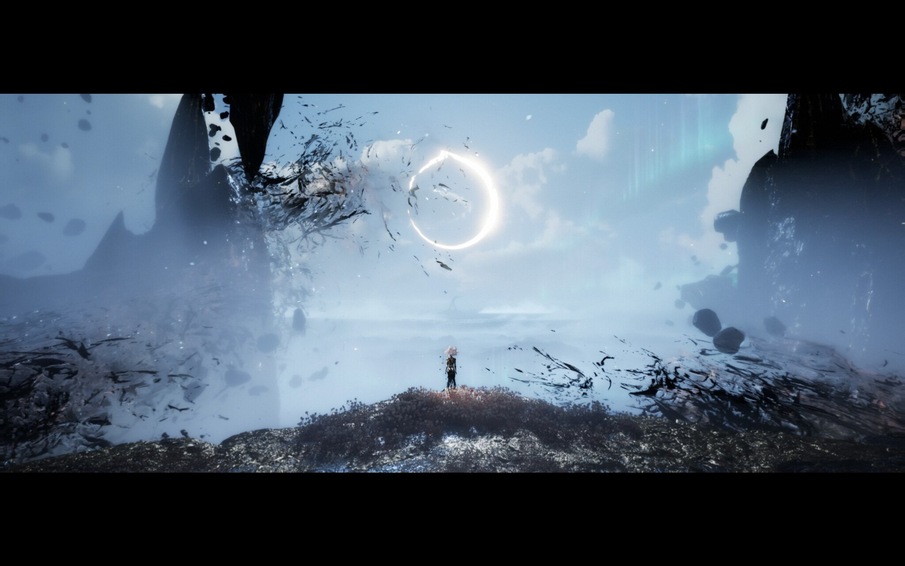
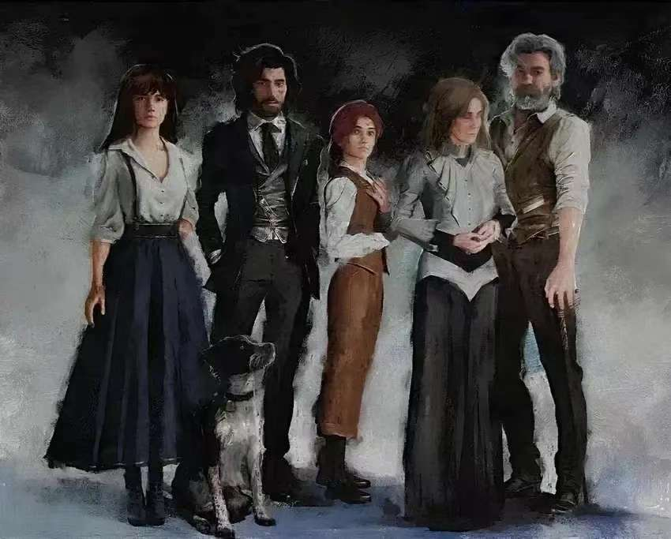

## 美好年代

故事要从19世纪末的法兰西说起。那是史称“美好年代”的岁月。整个世界仿佛都相信，明天只会比今天更好。狄桑德一家就生活在这样的光里。母亲阿莉涅是画师协会的主席，笔下能让画中的世界活过来；父亲雷诺阿同样执笔，长女克莱雅天赋最高，长子维尔索偏爱音乐，幼女阿莉西亚偏爱文字。他们是那个时代最体面、也最令人羡慕的一家人。

然而画师与文客之间的积怨早已暗流涌动，1905年12月的某一天，一场大火在狄桑德庄园燃起。那一天的日期是“12月33日”，历法上本不存在的一天。维尔索冲进火场救妹妹，没有再走出来。阿莉西亚活了下来，却失去了声音，半边脸被烧伤。母亲找到了维尔索留在世上的唯一一幅画，那是他孩提时随手绘下的世界。她闭上眼睛，走了进去。

## 卢明城的最后一个黄昏

画里有一座城，叫卢明。城里的人早已习惯了一件事：每年，海的那一边，那座被称作纪石的巨碑上，会被写下一个数字。绘母把它画在石上，年龄大于等于这个数字的人，便会化作花瓣，随风散尽。这被称为“抹煞”。数字一年比一年小，城里的人也一年比一年少。

那一天，人们穿上最好的衣服，聚到街头唱歌跳舞，近乎庆祝般迎接这场屠杀。《Lumière》的旋律轻快，高昂的曲调底下藏着一丝不安，鼓点越敲越响。古斯塔夫陪着女友索菲站在人群里，等待着抹煞的来临。傍晚，数字落下，被抹煞的人化作漫天花瓣，索菲也在他面前变成花瓣渐渐消散。这一年，纪石上写下的数字是33。

卢明人没有就此认命，每年都有一支远征队出海去寻找绘母，终结这场循环，而他们从来没有回来过。第一支出发的远征队为0号远征队，也是规模最庞大的一支远征队。之后每一队都由即将被抹煞的成员组成，队号为出征那一年纪石上的数字。古斯塔夫是33号远征队的一名队员，同行的有把他当作兄长的少女玛埃尔，有性格冷静的吕涅，有温和而坚韧的熙艾尔。那些逝去的远征队前辈，他们都是在为后来者铺路。“For those who come after.”

## 出师不利

一天夜晚，远征队抵达暗影海滩。当它们登上这座阴森恐怖的神秘海岛时，一个古怪的老头站在他们对面，他的右眼有一道疤痕。队员们还在疑惑他为什么没被抹煞，电光火石之间，他手起刀落，将一名队员切成两半，远征队瞬间一片混乱。他没有停下，继续大开杀戒。古斯塔夫还没缓过神，又被眼前突然出现的无头触手怪怔住。当触手怪即将吞噬他时，维尔索出现救下了他，并把他转移到了春意原野。不过古斯塔夫已失去意识，并不知道这一切。

这片大陆相对安全一些。遍体鳞伤的古斯塔夫艰难睁开双眼，还是不敢相信眼前发生的一切。他漫无目的的走着，突然间来到一个堆满尸体的洞穴，又想起刚刚的经历，心生绝望。他将枪口对准自己的太阳穴，正要开枪时，吕涅出现了，经过一番激烈的争辩，古斯塔夫算是收拾好了绝望的心情，虽然现状糟糕至极，但还是为后来者做一些贡献。之后，他们在这里找到了仅剩的几位队员玛埃尔和熙艾尔，并在一个山洞里认识了埃斯基耶。

他们走到了石涛崖。在山洞的出口战胜强大的经怪司灯后，吕涅和熙艾尔已经乘着埃斯基耶跳下山崖，准备前往下一个地方。此时，那个男人再次出现，那个在暗影海滩几乎灭掉整个远征队的古怪老头，雷诺阿。他只是挥了一下拐杖，古斯塔夫便倒下了。维尔索再次赶来救援，但这次他却刻意晚了一步。

古斯塔夫躺在妹妹的怀里。玛埃尔低着头，手指攥着他的衣襟，说不出话来。他没有留下什么豪言壮语，也没有交代什么遗愿，在这样一个静谧得近乎温柔的瞬间，他的呼吸慢慢停了。玛埃尔把他的机械手臂带走了，那是他的一部分。

## 踏上远征

维尔索替代古斯塔夫走进了队伍。他们一路走到废弃的古战场。画面里漫天红叶，空气里却满是铁锈的味道。这座战场见证过无数支远征队的败亡。维尔索走在他们的尸骨之间，沉默不语。他见过太多这样的结局，所有人都在为了一个看似正确的目标奔赴死亡，只有他知道，这趟路的终点并不是故事里说的那样。又经历数场恶战后，玛埃尔找到一棵大树，将古斯塔夫的机械臂放在树前，让他有了安息之地。


落叶地，他们捡到35号远征队的日志：“他们挺身而出，与之战斗到血尽而亡，牺牲之时还用自己的肉体为后来者架起了桥梁……”冰封之心，他们捡到了51号远征队的日志：“我们感情比血浓，比爱深。共同经历了这些，才会携手共进，才会彼此信任……”

## 宅邸

宅邸藏在画界的各个角落，几乎每一张小地图里都有一扇通往它的门。玛埃尔夜里反复梦见同一个场景：白发的男人和蒙着面的女孩站在她面前，指责她，说一切都是她的错。她不明白。她只知道，那座宅邸令她感到一种说不清的熟悉，仿佛她曾经在这里长大。在宅邸门前，远征队第一次与雷诺阿正面对峙。他是远征队中的“艺策人”，是0号远征队的队长，也是维尔索曾经的同伴。他站在众人面前，神色沉重，像一个不得不动手的父亲。最终维尔索战胜了雷诺阿，但是，只是画中原有的雷诺阿，而非雷诺阿本人。

## 真相

穿过重重阻碍，远征队终于抵达了纪石。石的内部，是一间间按倒叙排列的记忆。烧毁的画作；阿莉涅教三个孩子绘画的午后；她与丈夫之间愈发冷淡的沉默；与克莱雅的争吵；在琴边教维尔索弹琴的时光。再往深处，是与雷诺阿最美好的那段日子。

雷诺阿从那对相拥的身影下走了出来。这时，所有的碎片才拼在了一起。画里的世界，是母亲因为失去儿子而画下的；画里的人，是她按记忆描摹的家人，包括维尔索，包括丈夫，包括女儿；而每年的抹煞，是现实里的雷诺阿为了逼妻子出画，在这个世界里动的手。大崩析是他们夫妻在画里的一场大战，从那以后，世界只剩下被海洋隔开的一小块。画中永远复活的人是她，每年带来死亡的人是他。

远征队以为自己在讨伐一个魔物，其实他们闯进了一场家庭争吵的正中央。而维尔索，也终于说出了自己的秘密。他在这之后便只剩下疲倦。一次又一次地看着远征队出发，一次又一次地看着他们死去。

他们很轻松的击败了绘母阿莉涅，然后，真正的抹煞降临了。雷诺阿收回了他的手，所有人都化作花瓣，散在风里。玛埃尔再一次睁开眼睛，她的头发已经变成了白色，记忆如潮水般涌回：她是现实中的阿莉西亚，那场火是她点着的，哥哥因为她而死，她入画是为了去救母亲。当时，她的记忆被抹去，成了画里新生的玛埃尔。但她不想再回现实去了。



## 泰坦

在画界里，雷诺阿留下了四个泰坦：千面、塞壬、探天，以及一个没有名字的。它们分别是他给四个家人画的画像。千面是维尔索，画里藏着一句话：艺术应该既是窗，也是镜子；塞壬是阿莉涅，那是他对完美的追问；探天是阿莉西亚，他对女儿说，抬头看看天，这些都是你的；最后那个没有名字的，是克莱雅，是他对长女无声的控诉，也是无声的期待。每一个泰坦都是一次对家人的凝视。远征队一个一个击败它们，像是在拆开一个家庭的伤疤。

## 最终之战，雷诺阿

远征队在战胜两个泰坦之后，重返卢明城，与雷诺阿展开最后的决战。这一战的音乐是《Une vie à t'aimer》，每一个音符都在撕扯着心脏。他想要把爱人从虚幻里带回来，哪怕代价是让整个世界毁灭。他让所有人看到了现实中的阿莉涅：一具躺在床上，如同活死人一般的身体，一天比一天更加虚弱。

“她曾经救过深陷画中的我，是她教会了我什么时候该放手。”这句话让维尔索的手停了下来。他从一开始就在动摇：毁掉这幅画是为了让母亲活下去；可毁掉这幅画，也意味着让朋友、同伴、自己，所有人一同消失。他是画中人，却又拥有现实里死去的那个维尔索的记忆。

战斗结束，雷诺阿被阿莉西亚与维尔索送回现实世界。最后的选择落到了两个人的肩上：一个是想保留画作，继续留在画中的阿莉西亚；一个是一心想销毁画作，终结这一切的维尔索。

## 用一生去爱

二周目我站在了维尔索那一边。他击败了阿莉西亚，将她送回现实。维尔索看着自己灵魂的残影，一步一步，走进了光里。随后画面一转，回到了现实，维尔索的葬礼。这一次克莱雅收起了往日的傲气，雷诺阿与阿莉涅在墓前相拥，阿莉西亚怀里抱着埃斯基耶，静静站在那里。

墓碑上刻着：

```
亲爱的维尔索·狄桑德
1879年2月22日 – 1905年12月33日
永远铭刻在我们心中
```

宅邸最深处，有一份日志：“绝大多数人都是过客，只有你对自己可以始终不离不弃。小家伙，抬头看看天空的浩瀚，你便会明白，生活并不仅仅是你所见所想的那样。伸出手来，这些都属于你……”



2025年4月25日就买了《光与影：33号远征队》，却一直拖到6月底才开始玩。一周目22小时，选了妹妹结局；二周目25小时，选了哥哥结局，顺带全成就。总的来说，画面、氛围和音乐都做到了极致，玩完之后真的像患上了“司汤达综合征”：面对无与伦比的艺术，常常愣在原地，半天回不过神。