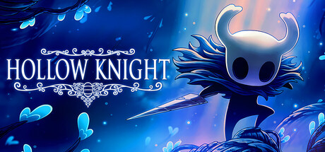
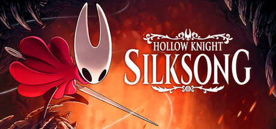
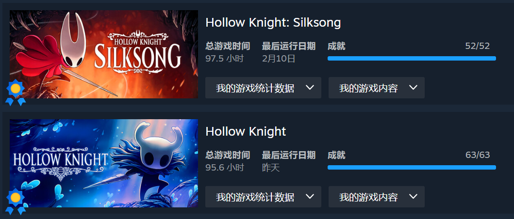

On February 10, after five months of playing on and off, I finally unlocked every achievement in Silksong, and my journey through Pharloom came to a close. Hollow Knight and Silksong, the product of more than a decade of Team Cherry's devotion, have become the highest mountain and the longest river of the Metroidvania genre.

## I. The Legend Begins: Hallownest

Three scenes left the deepest impression on me while playing Hollow Knight, and each corresponds to one of the game's most iconic passages of text:

**1. City of Tears**

Taking the lift down into the City of Tears, the music swells and the rain-soaked western half of the city comes into view. Everything suddenly opens up, like finding a village beyond the willows just when the path seemed to end. Walking on until you reach the statue of the Hollow Knight, the music hits its peak, and the sense of the sacred and the solemn suddenly becomes tangible. In that moment the little Knight, too, takes on a deeper sense of mission and duty. (In memory of the Hollow Knight: beneath that high black dome, its sacrifice keeps Hallownest eternal.)

**2. The Abyss**

Climbing out of the pile of shells and slowly jumping upwards, the music grows ever more tragic, until at last you see the Pale King and the Hollow Knight. The moment the Hollow Knight turns its head, it is already fated to be impure. This scene also gave birth to the finest text in the whole game: "No mind to think. No will to break. No voice to cry suffering. Born of God and Void. You shall seal the blinding light that plagues their dreams. You are the Vessel. You are the Hollow Knight."

**3. Resting Grounds & Blue Lake**

The music of the Resting Grounds is emotionally rich and deeply atmospheric. Solemn mourning, eternal sleep, whispers of the starry sky, sparseness and empty space: it captures the union of sorrow and beauty perfectly. Beside Blue Lake, Quirrel speaks the most thought-provoking line of all: "I've forgotten all the tragedy, and see only the wonders..."

## II. The Weaver's Eternal Epic: Pharloom

Spiralling upwards from Moss Grotto, you pass through the slums at the very bottom, the eerie town of Bellhart in the middle, and the Citadel at the top, prosperous on the outside and hollow within. At the summit, in the Cradle, you defeat Grand Mother Silk, then descend to the deepest depths of the Abyss to defeat Lost Lace. Along the way you climb Mount Fay, drop into pools of lava, cross windswept sands and wade through Bilewater... It is fair to call it an insect version of the Eighty-One Trials from Journey to the West. The hardships of the road transform Hornet from someone who only wanted to find out what was going on into the saviour of a kingdom gripped by the silk curse. What stays with me most, of course, is the last thing Hornet says before the final battle in the Abyss: "I have endured the countless thorns of Pharloom, and witnessed wonders amid peril. But I will always be a daughter of Hallownest, and of the Void at the bottom of all things... I am no longer afraid!"

**1. Shellwood**

In the first release of Silksong on September 4, 2025, the Chinese translation called this area 甲木林, which was later changed to 壳木林.

Arriving in Shellwood in Act 1, it reminded me of Greenpath in Hollow Knight, its defining quality being tranquillity. Returning in Act 3, it felt more like the Queen's Gardens, secluded and profound. The music seems almost enchanted: in Act 1 it is simply tranquil, but in Act 3 it carries an extra layer of eeriness and depth, and you suddenly realise this area is something special, a clever fusion of Greenpath and the Queen's Gardens from the first game.

**2. Bilewater & Putrified Ducts**

Bilewater must be the "smelliest" map in the history of video games. These two areas stuck with me purely because they are so disgusting. Nasty enemies, few save points, dark maps, a frightening atmosphere, endless traps, revolting maggot water, a gauntlet of enemies before the boss, a nasty boss fight, a boss arena miles from the nearest bench, enemies that drop no money, and even a fake bench! Truly disgusting! The only redeeming feature is the good music. Yet once I'd finished, it was just like that line from Hollow Knight: "I've forgotten all the tragedy, and see only the wonders." That line is the true core of Team Cherry's games. The quality is so high that you forgive all the malice they cram into them.

**3. Sands of Karak & Coral Tower**

In Act 2, I opened the map and noticed a dark, unexplored patch on the far left of the Blasted Steps. Heading over, I found a screen full of wind and sand. But I refused to believe there was no hidden path, so I kept pushing up and to the left, and sure enough, I found a secret passage into an entirely new area: the Sands of Karak. This was once the Coral Tower, ruled by Crust King Khann, but because of the Citadel's many misdeeds, the water ran dry and the stone crumbled, turning a teeming sea into the sand-swept caverns you see today. The Coral Tower of old, seen in Khann's dream in Act 3, is still breathtaking. Sadly, it seems this area was cut during Team Cherry's development, leaving only a small portion behind.

A fully upgraded Hornet is far more capable than the little Knight. Over these seven years of development, Team Cherry was not only writing code diligently but honing their craft to perfection, managing to design bosses that still feel hard even against such a powerful moveset. On top of that, the art builds on the first game and reaches new heights. While playing, I spent most of my time locked in high-pressure fights and barely noticed the details of the level design or the music, but once things calm down, you realise Silksong's art is truly unrivalled.

Of course, no game is flawless, but I think this one comes very close. My only real complaint is that rosaries are far, far too scarce in Act 1. There is plenty to buy in Act 1, but enemies drop so few rosaries that on every save file I had to farm money in the Citadel in Act 2. If you're less skilled and die more often, you'll have even fewer rosaries, not even enough to get through Act 2.

## III. The People's Cherry: Making Games with Heart

Since its release, Hollow Knight has received four DLCs, Lifeblood, Hidden Dreams, The Grimm Troupe and Godmaster, and this February it was patched again to fix some small issues. For a game this size, a price of ¥58 can no longer be called merely cheap. It's practically charity. No, it's disrupting the market! Team Cherry once said that Silksong was originally meant to be a free DLC for Hollow Knight, but during development the team had a burst of inspiration and kept adding new things, until it grew so large that they simply released it as a standalone sequel. Likewise, for a game of Silksong's size, ¥76 is absolutely worth it. A normal first playthrough takes about 40 hours, and 100% completion about 60 hours, which more than justifies the price. At the end of last year, Team Cherry even announced that a free DLC for Silksong is in the works. That's incredibly generous.

Both games are rock-solid in quality, each standing head and shoulders above the rest of the Metroidvania genre. Team Cherry really makes games with heart. They are completely immersed in their own art.
