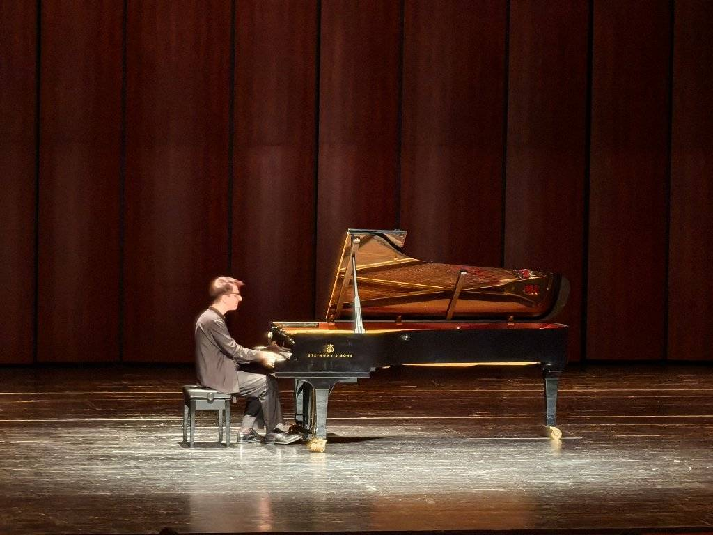
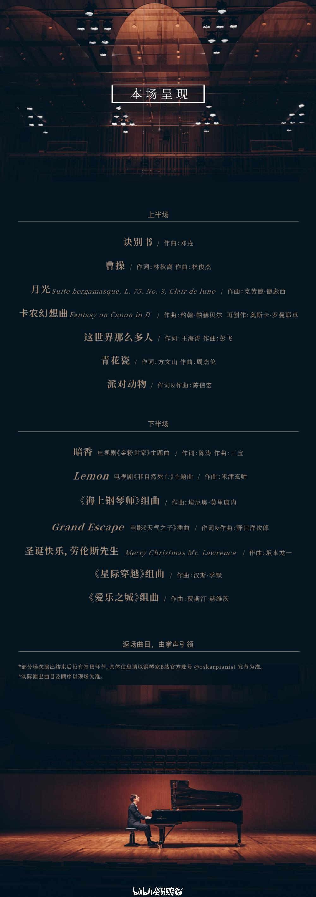

最近心里总像压着一团湿棉花，说不上是哪件事，只是闷，只是躁，坐在屋里读不进书，也写不出字。于是我买了一张票，一个人去了珠海华发中演大剧院，想把自己交给一个晚上，交给一架钢琴。

歌剧厅的灯一寸一寸暗下去，我坐在中间偏左、靠走廊的位置，周围是窸窸窣窣的低语，渐渐也静了。舞台上只有一架三角钢琴，琴盖高高支起，像一只收拢了翅膀、等待起飞的黑鸟。

## 一、开场曲《这世界那么多人》

第一个音落下来的时候，我忽然觉得，这个晚上大概是来对了。《这世界那么多人》本是一首唱给遗憾的歌，歌词里的人海茫茫，隔着钢琴听来，却少了几分哀怨，多了几分温存。没有人声，旋律便自己开口，一句一句，像有人在你耳边轻轻说话。

一曲终了，掌声礼貌而温热。他起身致意，用不太流利却很真诚的中文说，自己五岁就开始学钢琴，而现在，特别喜欢两首流行乐。台下有人会心地笑了。我们都等着他说出是哪两首。

## 二、流行乐《曹操》与《青花瓷》

是《曹操》，是《青花瓷》。

一个来自西方的钢琴家，把林俊杰的那份苍凉与周杰伦的那抹水墨，一并请上了他的黑白琴键。《曹操》里的沉郁在低音区缓缓铺开，像夜色漫过城楼；到了《青花瓷》，琴声忽然变得很轻，轻得像笔尖蘸了淡墨，在宣纸上洇开一朵素净的花。我坐在黑暗里，想起这两首歌是多少人的少年岁月。原来好的旋律从不认国界，也不认乐器，它只认愿意倾听的人。

## 三、自改编曲《卡农幻想曲》

帕赫贝尔的《卡农》，大概是世上最耳熟的旋律之一，一层叠着一层，前一个声部刚刚走远，后一个声部便轻轻跟上。

而这一晚的《卡农幻想曲》，是他自己的再创作。熟悉的主题像老友一样在曲中不时现身，却又总在转角处拐进意想不到的和声里，仿佛一个人沿着旧路散步，走着走着，竟走进了一片从未见过的花园。我这才明白，所谓改编，并非把旧曲子重新演一遍，而是借别人的灯，照亮自己心里的那间屋子。

## 四、高潮《圣诞快乐，劳伦斯先生》与《爱乐之城》组曲

下半场，真正让我屏住呼吸的，是这两段。

《圣诞快乐，劳伦斯先生》的前奏一响，整个歌剧厅仿佛被冻住了。那几个清冷而干净的音符，像雪夜里落在窗沿的第一片雪。我想起，写下它的坂本龙一已于2023年辞世。这首曲子出自他亲身参演的电影，如今他不在了，旋律却还在，由另一双手、另一架琴，在另一片夜空下，一遍一遍地唱给陌生人听。人会走，音乐不会。这句话说起来轻飘飘的，可当我真的坐在台下，听着那些音符一颗一颗落进黑暗，才第一次觉得它有重量。

紧接着是《爱乐之城》组曲。电影里那对追梦的男女，在星空下起舞，在选择中错过，最后隔着人海相视一笑。《Mia & Sebastian's Theme》在他指下缓缓流淌，带着一点甜，一点痛，还有一点“如果当初”的怅惘。

前一首是告别，后一首是梦想，一个让人想起失去，一个让人想起曾经热烈地爱过、追过。夹在这两首之间，我忽然觉得，那团压在心里的湿棉花，被什么轻轻地拧干了一点。

## 五、落幕曲《海上钢琴师》组曲

埃尼奥·莫里康内的《海上钢琴师》，是一个终生未曾下船的人的故事。1900在海上弹了一辈子琴，听众是起伏的海浪和来来去去的旅人。

这组曲子被他弹得很满，也很空，满的是旋律里涨潮般的深情，空的是尾音散去后那片辽阔的寂静。当最后一个和弦落下，全场沉默了足足几秒，才爆发出雷鸣般的掌声。

## 六、即兴加曲《光年之外》

他没有急着退场，而是邀请全场观众，一起合了一张影。灯光亮起，几百个人举着手机，笑成一片，仿佛一场安静的演出，在这一刻忽然有了人间烟火。

然后他回到钢琴前，说：“如果你们感兴趣的话，我还可以分享一些我喜欢的曲子。”多么谦逊的一句话。台下的回答，是更响亮的掌声。

他弹起了《光年之外》。那个原本属于人声的、飞扬的、带着少年倔强的旋律，在琴键上变得柔软而辽远。一光年有多远呢？大概就是一个人和另一个人之间，那段看似遥不可及、却被一首歌轻轻跨过的距离。

## 后记

散场的时候，夜风很软。我沿着人潮慢慢往外走，耳朵里还回荡着那些音符。说来奇怪，我并不是个懂乐理的人，说不出哪一处用了怎样的技法。我只知道，他弹得很有感情，每一个音都像是认真想过才落下，那份认真穿过了琴盖，穿过了黑暗，真的落进了我的心里。

来时烦躁焦虑，归去时竟轻了许多。一音一韵，皆是深情，大约就这样吧。

