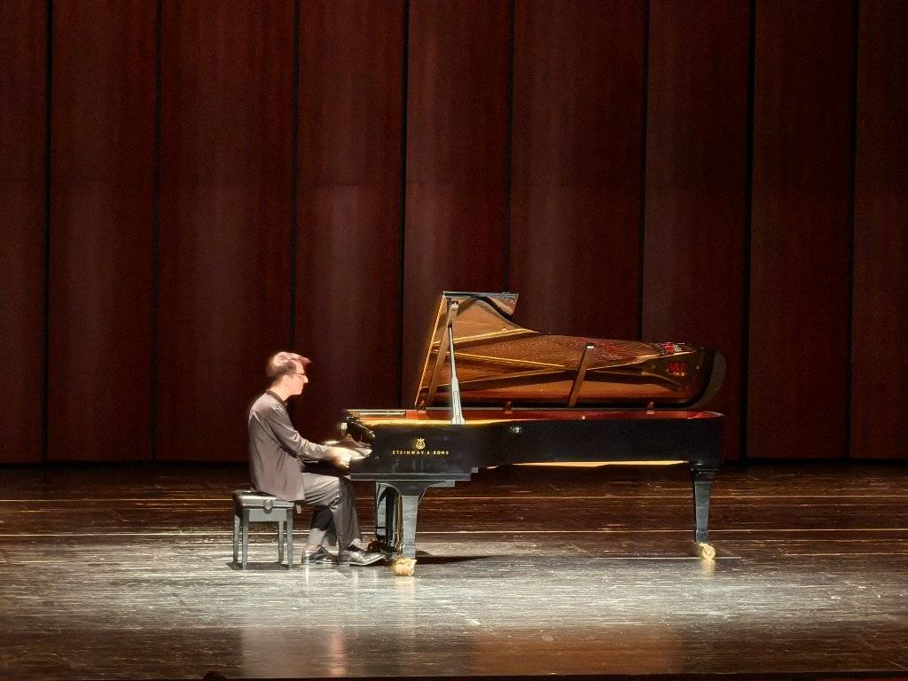
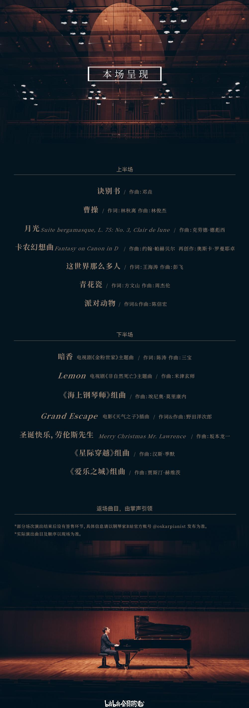

最近心里有点烦躁不安，坐在屋里读不进书，每当想要学习时总能有一万个理由说服自己再玩一会，玩的时候又总是想着作业还没写，应该去学习一下了。我也不想再像这样卷也卷不动，躺也躺不平了。正好在b站上看到o叔的巡演，于是我买了一张票，一个人去了珠海华发中演大剧院，想着彻底放松一下。

随着巡演开始，歌剧厅的灯一寸一寸暗下去，我坐在中间偏左、靠走廊的位置，周围是窸窸窣窣的低语。剧院的灯已经全部熄灭，而o叔还在等待，我想他应该是觉得还不够安静。这些窃窃私语也使我本就烦躁的心情更上一层楼。时间慢慢流逝，在场的观众逐渐意识到自己应该保持安静而不再出声，可就是不能所有人同时保持安静，就像反比例函数无限趋近于x轴却就是不能到达。当噪声终于低于某个阈值时，o叔开始了他的表演。

## 一、开场曲《这世界那么多人》

舞台两侧的辅助屏幕呈现出一行字：这世界那么多人。开场曲选的非常巧妙，仿佛也在提醒观众保持宁静。《这世界那么多人》本是一首唱给遗憾的歌，歌词里的人海茫茫，隔着钢琴听来，却少了几分哀怨，多了几分温存。一曲终了，掌声礼貌而温热。他起身致意，用不太流利却很真诚的中文说，自己五岁就开始学钢琴，而现在，特别喜欢两首流行乐《曹操》与《青花瓷》。

## 二、流行乐《曹操》与《青花瓷》

一个来自西方的钢琴家，把那份悲壮与那抹诗意，在琴键上体现的淋漓尽致。两首曲目他都有轻微的改动。《曹操》把节奏轻轻挪了一下——原曲是硬的，一句顶一句往前推；到他手里，一收一放，反而更自然更有韵律感。《青花瓷》虽也有微调，但还是一样的流畅、婉转。掌声响起时，我才把手从膝盖上拿开。

## 三、自改编曲《卡农幻想曲》

下一首是《卡农》。他与观众调侃道：“想必大家已经听了太多次原曲了吧，今天这首《卡农幻想曲》是我依据自己的经历改编的，希望你们能够喜欢。”琴声悠扬，熟悉的主题像老友一样在曲中不时现身，却又总在转角处拐进意想不到的和声里。这次改编削弱了流畅性，更突出了节奏感，也是想让平淡的生活增添一些波折，增添一些乐趣吧。

## 四、高潮《圣诞快乐，劳伦斯先生》与《爱乐之城》组曲

其实，我就是因为演出曲目表上有这两首才来的。

下半场，《圣诞快乐，劳伦斯先生》的前奏一响，瞬间营造出黯淡忧伤的氛围，像雪夜里一个人蜷在被窝里。写下它的坂本龙一已于2023年辞世。这首曲子出自他亲身参演的电影，如今他已不在了。我不禁想起最近浑浑噩噩的日子，失去了目标，什么也不想干，每天都在感慨时间过的好快，却每天都在浪费时间。顺着这哀伤的基调，脑海中又浮现出诸多不顺的往事，唉，往事不堪回首。

不行，人不可以这么堕落。紧接着是《爱乐之城》组曲。电影中《City of Stars》最先只是塞巴斯蒂安独自在桥上哼的小曲，孤独又迷茫，随后当两人关系升温，音乐也来到高潮，欢快激昂，这个时候最有恋爱的感觉，可是在最后还是分离，留下的只有回忆。City of stars, are you shining just for me? 生活啊，你可以让我更顺利一点吗？Who knows? 谁又能一帆风顺呢？

## 五、即兴加曲《光年之外》

演出结束时，他没有急着退场，而是邀请全场观众，一起合了一张影。灯光亮起，几百个人举着手机，这一刻忽然有了人间烟火。随后他回到钢琴前，说：“如果你们感兴趣的话，我还可以分享一些我喜欢的曲子。”

他弹起了《光年之外》。那个属于人声的、飞扬的、带着少年倔强的旋律，彻底点燃了现场的热情。一光年遥不可及，正如理想与现实的距离。难道因为追不上理想而不去追了吗？不行，人不可以这么堕落。

## 后记

曲终人散。我沿着人潮慢慢往外走，脑海里还回荡着那些旋律。其实我并不是个懂乐理的人，说不出什么技巧。但我知道，他弹得很有感情，他所营造的氛围能盖过我的烦躁，于是我可以专心欣赏他的艺术，跟随他的音乐而浮想联翩。

